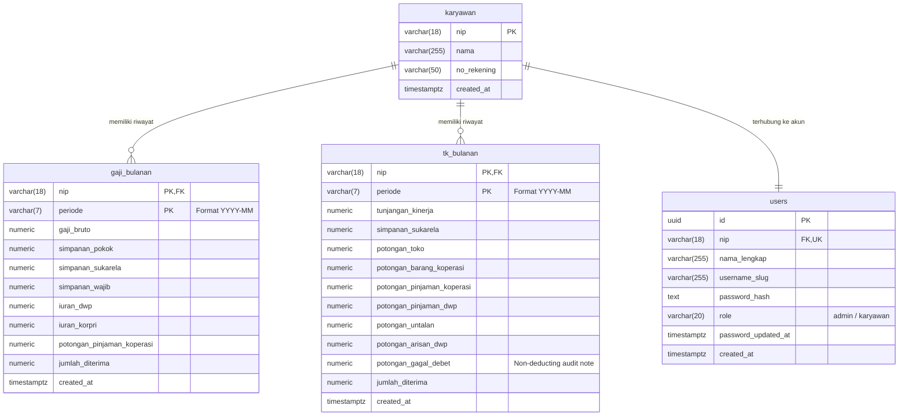

# HaloPay BPS Jatim: Sistem Pemantauan Pendapatan & Tunjangan Kinerja Pegawai

Platform modern terintegrasi berbasis **Next.js 16 (Frontend)**, **FastAPI (Backend)**, dan **PostgreSQL 16 (On-Premise Database)** yang dirancang khusus untuk digitalisasi, penatausahaan, visualisasi, dan verifikasi nota resmi penghasilan pegawai (Gaji Pokok & Tunjangan Kinerja) di lingkungan **Badan Pusat Statistik (BPS) Provinsi Jawa Timur**.

Sistem ini mentransformasikan pemrosesan spreadsheet manual menjadi alur kerja terotomasi yang aman (*Zero Data Leakage*), akurat, dan transparan bagi pengelola keuangan (Administrator) maupun seluruh pegawai (Karyawan).

---

## 📚 Panduan Dokumentasi Terpusat

Proyek ini terbagi secara modular menjadi tiga komponen utama yang siap dideploy baik secara lokal maupun via kontainer:

* 📘 **[Dokumentasi Frontend Next.js](frontend/README.md):** Panduan struktur direktori, komponen UI, styling cetak A4, dan alur autentikasi SSO Keycloak.
* 🐍 **[Dokumentasi Backend FastAPI](backend/README.md):** Panduan arsitektur REST API, skema Pydantic, koneksi database asyncpg, dan pengujian otomatis Pytest.
* 🐳 **[Panduan Orkestrasi Docker & Docker Compose](DOCKER.md):** Petunjuk sistematis langkah-demi-langkah orkestrasi 3 kontainer (`halopay-db`, `halopay-backend`, `halopay-frontend`) dan konfigurasi variabel lingkungan.

---

## 🌟 Fitur Utama

### 1. Zero Data Leakage Architecture (FastAPI Backend)
* **Pemisahan Kueri Sensitif:** Seluruh kueri data finansial dan identitas pegawai diproses di sisi server backend Python (FastAPI). Tidak ada pemanggilan database langsung dari browser client (*Zero Client Direct DB Query*).
* **Single Round-trip Aggregated Bundle:** Endpoint komposit `/api/v1/payroll/dashboard-bundle` menyajikan nota transaksi dan deret analitik grafik dalam 1 koneksi terpadu berlatensi ultra-rendah (<80 ms).
* **Sanitasi Skema Otomatis & Auto-Discovery:** Menangani batch upsert data gaji dan tunjangan kinerja dengan pembersihan kolom non-skema secara ketat, serta mendeteksi otomatis (*auto-discovery*) pegawai baru untuk didaftarkan ke tabel master `karyawan`.

### 2. Autentikasi Pegawai & Role-Based Access Control (RBAC)
* **Integrasi Single Sign-On (SSO Keycloak BPS):** Masuk terpadu menggunakan akun SSO instansi dengan alur otorisasi OIDC (Authorization Code Flow with PKCE).
* **Manajemen Sesi Aman (Stateless):** Token sesi berbasis JWT berdurasi 8 jam diterbitkan oleh backend, disimpan dalam cookie `HttpOnly`, `SameSite=Lax`, dan terproteksi dari ancaman XSS/CSRF.
* **Keamanan Kunci JWT:** Kunci `JWT_SECRET` dikelola secara eksklusif oleh server backend dan tidak pernah dipaparkan ke frontend.
* **Pembagian Peran Pengguna (RBAC)**:
  * **Administrator**: Mengunggah berkas spreadsheet, memantau ringkasan statistik masal, meninjau nota slip seluruh pegawai secara individual, serta mengelola data master pada panel kendali data (CRUD).
  * **Karyawan**: Mengakses rincian penghasilan pribadi, melihat grafik riwayat tren pendapatan, dan mencetak nota resmi slip gaji/TK ke format A4.

### 3. Mesin ETL Payroll & Parser Cerdas (SheetJS)
* **Deteksi Lembar Kerja Otomatis**: Sistem secara cerdas mendeteksi lembar Gaji (`GAJI`, `Gaji`, `gaji`, atau sheet `15`) dan lembar Tunjangan Kinerja (`TK`, `tk`, `Tk`, `tukin`, atau sheet `16`).
* **Parser Rupiah Lintas Format (`parseNumeric`)**: Menangani variasi format angka accounting Indonesia maupun internasional secara akurat.
* **Rentang Tahun Fleksibel:** Mendukung pemilihan tahun multi-dekade ditambah mode *Ketik Manual* untuk migrasi arsip data masa lalu.
* **Aturan Khusus Gagal Debet**: Komponen potongan gagal debet diperlakukan secara tepat sebagai catatan audit rekonsiliasi bank non-pengurang (*non-deducting audit note*).

### 4. Nota Rincian Slip Gaji & TK (Siap Cetak A4 / PDF)
* **Format Dokumen Resmi**: Dilengkapi dengan identitas kop surat instansi Badan Pusat Statistik.
* **Kelengkapan 13 Pos Potongan**: Menampilkan secara konsisten seluruh pos kewajiban/potongan.
* **Cetak Langsung**: Tombol cetak langsung memicu dialog pencetakan peramban dengan layout A4 yang bersih tanpa elemen navigasi website (*no-print stylesheet*).

### 5. Visualisasi & Analisis Finansial
* **Waterfall Dekonstruksi Pendapatan**: Komponen visual progresif multi-warna yang memetakan aliran penghasilan kotor (*Gross Inflow*), total potongan gaji, total potongan TK, hingga nominal bersih yang diterima (*Net Take Home Pay*).
* **Grafik Riwayat Tren Pendapatan**: Visualisasi grafik interaktif antar-periode transaksi berbasis Recharts untuk memantau fluktuasi penghasilan pegawai secara historis.

---

## 🛠️ Tumpukan Teknologi (Tech Stack)

* **Backend REST API**: [FastAPI](https://fastapi.tiangolo.com/) (Python 3.11), [Uvicorn](https://www.uvicorn.org/), [Pydantic v2](https://docs.pydantic.dev/), [asyncpg](https://magicstack.github.io/asyncpg/), [HTTPX](https://www.python-httpx.org/), [Pytest](https://docs.pytest.org/)
* **Frontend Web App**: [Next.js 16](https://nextjs.org/) (App Router, Turbopack), [React 19](https://react.dev/), [Tailwind CSS v4](https://tailwindcss.com/), [Lucide React](https://lucide.dev/), [Recharts](https://recharts.org/)
* **Basis Data**: [PostgreSQL 16](https://www.postgresql.org/) (Skema mandiri terisolasi `karyawan_bps` & ekstensi `pgcrypto`)
* **Autentikasi Eksternal**: Keycloak OIDC BPS
* **Pengolah Spreadsheet**: [SheetJS (xlsx)](https://docs.sheetjs.com/)
* **Kontainerisasi & Deployment**: [Docker](https://www.docker.com/) & [Docker Compose v2](https://docs.docker.com/compose/)

---

## 🏛️ Arsitektur Basis Data (Skema: `karyawan_bps`)

Sistem menggunakan skema terisolasi bernama `karyawan_bps` pada basis data PostgreSQL lokal:



---

## 🚀 Panduan Peluncuran Cepat (Docker Compose)

Cara termudah dan paling aman untuk menjalankan HaloPay adalah menggunakan **Docker Compose**:

### 1. Salin Repositori & Persiapkan Environment
```bash
git clone <url-repositori-anda>
cd sistem_payroll
cp .env.example .env
```

### 2. Atur Kredensial di `.env`
Buka file `.env` dan atur password database serta kunci JWT backend yang aman:
```ini
POSTGRES_USER=halopay_admin
POSTGRES_PASSWORD=your_secure_password
POSTGRES_DB=halopay_db

DATABASE_URL=postgresql://halopay_admin:your_secure_password@db:5432/halopay_db
JWT_SECRET=your_super_secure_random_jwt_secret_key_here

KEYCLOAK_URL=https://auth.majapah.it
KEYCLOAK_REALM=majapahit
KEYCLOAK_CLIENT_ID=halopay
NEXT_PUBLIC_APP_URL=http://localhost:3005
```

### 3. Bangun & Jalankan Kontainer
```bash
docker compose up --build -d
```
Semua tabel dan relasi skema `karyawan_bps` akan diinisialisasi secara otomatis oleh skrip di folder `database/init/`.

### 4. Akses Layanan
* **Frontend Web:** `http://localhost:3005` (atau port yang ditentukan)
* **Backend API & Swagger:** `http://localhost:8005/docs`
* **Healthcheck:** `http://localhost:8005/api/health`

---

## 🔒 Praktik Keamanan & Perlindungan Data

* **Strict Environment Isolation:** Tidak ada kredensial sensitif atau password yang ditulis *hardcoded* di kode sumber maupun `docker-compose.yml`. Seluruh konfigurasi diinjeksikan secara aman melalui berkas `.env`.
* **Zero JWT Secret on Frontend:** Sesi frontend hanya memvalidasi token secara stateless dan mendekode klaim (`id`, `nip`, `nama`, `role`). Kriptografi tanda tangan dan penerbitan token dilakukan sepenuhnya oleh backend FastAPI.
* **Kerahasiaan Basis Data (Zero Direct DB Access):** Browser klien tidak pernah memiliki koneksi langsung ke PostgreSQL. Seluruh akses difilter dan diautentikasi oleh backend FastAPI.
* **Role-Based Access Control (RBAC):** Rute `/admin/*` di frontend dilindungi oleh middleware Next.js, dan seluruh endpoint admin di backend (`/api/v1/admin/*`) diverifikasi secara ketat dengan dependensi `get_current_admin`.
* **Cookie Proteksi Tinggi:** Cookie sesi `bps_payroll_session` diset dengan flag `HttpOnly`, `SameSite=Lax`, dan `Path=/`.

---

## 📄 Lisensi & Hak Cipta

Dokumen dan kode sumber ini dikembangkan untuk kebutuhan sistem penatausahaan internal **Badan Pusat Statistik (BPS)**. Seluruh hak cipta dilindungi oleh ketentuan instansi yang bersangkutan.
