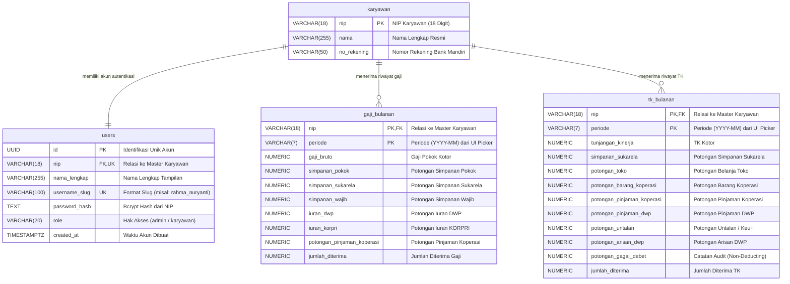

# Product Requirement Document (PRD)

## Sistem Pemantauan Pendapatan dan Tunjangan Kinerja Karyawan (Spreadsheet Auto-ETL Parser ke Supabase)

---

## 1. Ringkasan Eksekutif & Visi Produk

### 1.1 Latar Belakang

Pengelolaan dan pemantauan penggajian (Gaji Pokok) serta Tunjangan Kinerja (TK) bulanan karyawan pada instansi membutuhkan platform pemantauan yang terpusat, transparan, presisi, dan aman. Berkas *spreadsheet* dari divisi keuangan umumnya berupa data transaksi mentah tanpa kolom periode eksplisit, dengan format notasi ilmiah pada NIP, sel kosong atau tanda strip (`-`), serta kolom khusus seperti *potongan gagal debet* yang memiliki aturan kalkulasi tersendiri.

### 1.2 Visi Produk

Membangun platform pemantauan pendapatan karyawan berbasis web (*Payroll & Allowance Management System*) dengan prinsip antarmuka *corporate modern minimalist*. Sistem ini dirancang agar pengguna tidak perlu melakukan *formatting* atau pembersihan manual pada berkas Excel sebelum diunggah.

Fitur utama sistem mencakup:

1. **Autentikasi Sederhana Tanpa Email:** Menggunakan Nama Lengkap (dinormalisasi menjadi *slug*) dan NIP sebagai kata sandi dengan token JWT berdurasi terbatas.
2. **Dual-Role Access System:** Pembagian hak akses tegas antara **Karyawan** (akses mandiri slip digital dan analitik historis) dan **Admin** (kendali data CRUD dan pengunggah berkas).
3. **Client-Side Smart Excel Auto-ETL Engine:** Ekstraksi data langsung di peramban menggunakan pustaka `xlsx`, dipadukan dengan **UI Period Selector** (`YYYY-MM`) untuk mengeliminasi masalah *delimiter* CSV.
4. **Digital Pay Slip (Nota Rincian) & Visual Flow:** Tampilan berbentuk nota resmi yang memperlihatkan pendapatan kotor, dekonstruksi tiap pos potongan, hingga pendapatan bersih (*take-home pay*), dilengkapi tombol cetak dokumen.
5. **Interactive Data Control Table (CRUD & Realtime):** Tabel kendali data bagi Admin yang terhubung langsung ke skema PostgreSQL Supabase `karyawan_bps` dengan pembaruan data secara *real-time*.

---

## 2. Arsitektur Keamanan, Autentikasi & Hak Akses (RBAC)

### 2.1 Mekanisme Autentikasi (Nama Lengkap + NIP)

Sistem meniadakan kebutuhan alamat surel (*email*) agar alur masuk karyawan menjadi praktis dan langsung:

* **Identitas Akun (Username):** Pengguna memasukkan Nama Lengkap asli. Sistem di sisi peramban secara otomatis menormalisasi masukan tersebut menggunakan *regular expression* (menghapus tanda kutip/karakter khusus, mengubah spasi ganda menjadi garis bawah, dan mengonversi huruf menjadi huruf kecil).
* **Kata Sandi (Password):** Pengguna memasukkan NIP 18 digit resmi.
* **Validasi Server:** NIP diverifikasi terhadap nilai *hash* Bcrypt (`password_hash`) di tabel `karyawan_bps.users` menggunakan fungsi kriptografi PostgreSQL `pgcrypto`.
* **Manajemen Sesi:** Sesi diamankan menggunakan JWT (*JSON Web Token*) berdurasi terbatas (misalnya: 8 jam aktif) yang disimpan pada *Secure HTTP-Only Cookie* atau *Secure Storage*.

```
[ Input: Nama Lengkap ] ───> [ Normalisasi Regex ke Slug ] ───> 'rahma_nuryanti'
[ Input: NIP ]          ───> [ Validasi Panjang 18 Digit ]  ───> '198503142009022003'
                                        │
                                        ▼
                   [ Kueri DB: users WHERE username_slug ]
                                        │
             ┌──────────────────────────┴──────────────────────────┐
      [ Record Ditemukan ]                                  [ Tidak Ditemukan ]
             │                                                     │
             ▼                                                     ▼
[ Verifikasi Bcrypt NIP vs Hash ]                           [ Akses Ditolak ]
             │
             ├──────────────────┐
             ▼                  ▼
       [ NIP Cocok ]      [ NIP Salah ]
             │                  │
             ▼                  ▼
    [ Terbitkan JWT ]     [ Akses Ditolak ]

```

### 2.2 Algoritma Normalisasi Nama (*Slugification Utility*)

```typescript
/**
 * Mengonversi variasi penulisan nama lengkap ke format username_slug database.
 * Contoh penanganan:
 * - "Rahma Nuryanti"      --> "rahma_nuryanti"
 * - "  RAHMA   NURYANTI " --> "rahma_nuryanti"
 * - "Ni'matus Sholihah"   --> "nimatus_sholihah"
 */
export function normalizeUsernameSlug(input: string): string {
  if (!input) return '';
  return input
    .trim()
    .toLowerCase()
    .replace(/['`’]/g, '')
    .replace(/[^a-z0-9]+/g, '_')
    .replace(/^_+|_+$/g, '');
}

```

### 2.3 Matriks Hak Akses Berbasis Peran (*Role-Based Access Control*)

```
                       ┌─────────────────────────┐
                       │   Halaman Login (JWT)   │
                       └────────────┬────────────┘
                                    │
                    ┌───────────────┴───────────────┐
                    ▼                               ▼
          ┌───────────────────┐           ┌───────────────────┐
          │  Role: KARYAWAN   │           │    Role: ADMIN    │
          └─────────┬─────────┘           └─────────┬─────────┘
                    │                               │
 ┌──────────────────┴────────────────┐ ┌────────────┴─────────────────────┐
 │ • Dashboard Ringkasan Terpadu     │ │ • Memiliki Seluruh Akses Karyawan │
 │ • Nota Rincian (Gaji & TK)        │ │ • Smart Excel Uploader + Periode  │
 │ • Ekspor / Cetak Slip PDF (A4)    │ │ • Tabel Data Kendali (CRUD DB)    │
 │ • Chart Tren Historis & Potongan  │ │ • Supabase Realtime Listener      │
 └───────────────────────────────────┘ └───────────────────────────────────┘

```

#### A. Role Karyawan

* **Pemilih Periode Laporan:** Memilih bulan transaksi yang ingin diperiksa via *dropdown selector*.
* **Slip Digital / Nota Rincian Pendapatan:** Memeriksa rincian pendapatan dalam bentuk tabel nota formal (Gaji Kotor/TK Kotor, seluruh potongan, hingga nominal bersih *Jumlah Diterima*).
* **Cetak Slip Resmi (PDF):** Mengunduh atau mencetak langsung nota slip gaji/TK ke format dokumen cetak A4.
* **Analitik Historis (Visual Charts):** Grafik batang dan garis interaktif untuk membandingkan pendapatan kotor, akumulasi potongan, dan pendapatan bersih dari bulan-bulan sebelumnya.

#### B. Role Admin

* **Hak Akses Penuh Karyawan:** Dapat mengakses seluruh fitur dasbor personal pegawai.
* **Smart Excel Ingestion:** Mengunggah berkas `.xlsx` dan memilih target periode transaksi secara eksplisit dari komponen antarmuka.
* **Tabel Kendali Data (CRUD Grid):** Mengubah, menghapus, atau menambahkan baris master karyawan, transaksi gaji, dan transaksi TK secara interaktif.
* **Sinkronisasi Real-Time:** Perubahan data otomatis diperbarui ke layar admin lain melalui saluran Supabase Realtime (`postgres_changes`).

---

## 3. Skema Database Supabase (`karyawan_bps`)

Seluruh tabel disimpan di dalam skema PostgreSQL tersendiri bernama **`karyawan_bps`**.

### 3.1 Diagram Hubungan Entitas (ERD)



---

### 3.2 Skrip SQL DDL & Inisialisasi Administrator Awal

Jalankan skrip ini langsung pada panel **Supabase SQL Editor**:

```sql
-- 1. Mengaktifkan Ekstensi Kriptografi & Pembuatan Skema
CREATE EXTENSION IF NOT EXISTS pgcrypto;
CREATE SCHEMA IF NOT EXISTS karyawan_bps;

-- 2. Tabel Master Karyawan
CREATE TABLE IF NOT EXISTS karyawan_bps.karyawan (
    nip VARCHAR(18) PRIMARY KEY,
    nama VARCHAR(255) NOT NULL,
    no_rekening VARCHAR(50)
);

-- 3. Tabel Autentikasi Pengguna
CREATE TABLE IF NOT EXISTS karyawan_bps.users (
    id UUID PRIMARY KEY DEFAULT gen_random_uuid(),
    nip VARCHAR(18) UNIQUE NOT NULL REFERENCES karyawan_bps.karyawan(nip) ON DELETE CASCADE,
    nama_lengkap VARCHAR(255) NOT NULL,
    username_slug VARCHAR(100) UNIQUE NOT NULL,
    password_hash TEXT NOT NULL,
    role VARCHAR(20) NOT NULL CHECK (role IN ('admin', 'karyawan')),
    created_at TIMESTAMPTZ DEFAULT NOW()
);

-- 4. Tabel Transaksi Gaji Bulanan
CREATE TABLE IF NOT EXISTS karyawan_bps.gaji_bulanan (
    nip VARCHAR(18) NOT NULL REFERENCES karyawan_bps.karyawan(nip) ON DELETE CASCADE,
    periode VARCHAR(7) NOT NULL, -- Format 'YYYY-MM'
    gaji_bruto NUMERIC(15, 2) NOT NULL DEFAULT 0,
    simpanan_pokok NUMERIC(15, 2) DEFAULT 0,
    simpanan_sukarela NUMERIC(15, 2) DEFAULT 0,
    simpanan_wajib NUMERIC(15, 2) DEFAULT 0,
    iuran_dwp NUMERIC(15, 2) DEFAULT 0,
    iuran_korpri NUMERIC(15, 2) DEFAULT 0,
    potongan_pinjaman_koperasi NUMERIC(15, 2) DEFAULT 0,
    jumlah_diterima NUMERIC(15, 2) NOT NULL DEFAULT 0,
    PRIMARY KEY (nip, periode)
);

-- 5. Tabel Transaksi Tunjangan Kinerja (TK) Bulanan
CREATE TABLE IF NOT EXISTS karyawan_bps.tk_bulanan (
    nip VARCHAR(18) NOT NULL REFERENCES karyawan_bps.karyawan(nip) ON DELETE CASCADE,
    periode VARCHAR(7) NOT NULL, -- Format 'YYYY-MM'
    tunjangan_kinerja NUMERIC(15, 2) NOT NULL DEFAULT 0,
    simpanan_sukarela NUMERIC(15, 2) DEFAULT 0,
    potongan_toko NUMERIC(15, 2) DEFAULT 0,
    potongan_barang_koperasi NUMERIC(15, 2) DEFAULT 0,
    potongan_pinjaman_koperasi NUMERIC(15, 2) DEFAULT 0,
    potongan_pinjaman_dwp NUMERIC(15, 2) DEFAULT 0,
    potongan_untalan NUMERIC(15, 2) DEFAULT 0,
    potongan_arisan_dwp NUMERIC(15, 2) DEFAULT 0,
    potongan_gagal_debet NUMERIC(15, 2) DEFAULT 0,
    jumlah_diterima NUMERIC(15, 2) NOT NULL DEFAULT 0,
    PRIMARY KEY (nip, periode)
);

-- 6. Pengindeksan untuk Performa Kueri
CREATE INDEX IF NOT EXISTS idx_karyawan_bps_users_slug ON karyawan_bps.users(username_slug);
CREATE INDEX IF NOT EXISTS idx_karyawan_bps_gaji_periode ON karyawan_bps.gaji_bulanan(periode);
CREATE INDEX IF NOT EXISTS idx_karyawan_bps_tk_periode ON karyawan_bps.tk_bulanan(periode);

-- 7. Inisialisasi Akun Admin Pertama: Rahma Nuryanti (NIP: 198503142009022003)
INSERT INTO karyawan_bps.karyawan (nip, nama, no_rekening)
VALUES ('198503142009022003', 'Rahma Nuryanti', '-')
ON CONFLICT (nip) DO UPDATE 
SET nama = EXCLUDED.nama;

INSERT INTO karyawan_bps.users (nip, nama_lengkap, username_slug, password_hash, role)
VALUES (
    '198503142009022003',
    'Rahma Nuryanti',
    'rahma_nuryanti',
    crypt('198503142009022003', gen_salt('bf')),
    'admin'
)
ON CONFLICT (nip) DO UPDATE 
SET role = 'admin',
    username_slug = 'rahma_nuryanti';

```

---

## 4. Logika Bisnis & Rumus Kalkulasi Pendapatan

### 4.1 Rumus Gaji Bulanan

Total potongan gaji diakumulasikan dari simpanan pokok, simpanan sukarela, simpanan wajib, iuran DWP, iuran KORPRI, dan pinjaman koperasi:

$$THP_{\text{Gaji}} = \text{gaji\_bruto} - (\text{simpanan\_pokok} + \text{simpanan\_sukarela} + \text{simpanan\_wajib} + \text{iuran\_dwp} + \text{iuran\_korpri} + \text{potongan\_pinjaman\_koperasi})$$

### 4.2 Rumus Tunjangan Kinerja (TK) Bulanan

> **Ketentuan Bisnis Khusus:** Kolom `potongan_gagal_debet` tetap dicatat dan disimpan ke dalam database untuk keperluan rekonsiliasi data, namun **TIDAK MENGURANGI** nilai tunjangan kinerja bersih (`jumlah_diterima`).

$$THP_{\text{TK}} = \text{tunjangan\_kinerja} - (\text{simpanan\_sukarela} + \text{potongan\_toko} + \text{potongan\_barang\_koperasi} + \text{potongan\_pinjaman\_koperasi} + \text{potongan\_pinjaman\_dwp} + \text{potongan\_untalan} + \text{potongan\_arisan\_dwp})$$

---

## 5. Alur & Mesin Ekstraksi Otomatis (*Smart Auto-ETL Pipeline*)

Karena kolom periode **tidak tercantum secara eksplisit di dalam berkas Excel**, proses penentuan waktu transaksi disuntikkan secara otomatis melalui tombol pemilih periode (*UI Period Selector*) pada modul pengunggah.

```
[ Admin Memilih Periode di UI (Contoh: "2026-08") ]
                         │
[ Admin Mengunggah File Excel Asli (.xlsx) ]
                         │
                         ▼
┌────────────────────────────────────────────────────────┐
│     Milestone 1: Client Parsing & Sheet Detection      │
│  • Deteksi Sheet Gaji vs Sheet TK via header kolom     │
│  • Sanitasi NIP 18-digit dari float/notasi ilmiah      │
│  • Normalisasi nilai sel kosong / strip ('-') jadi 0   │
└────────────────────────┬───────────────────────────────┘
                         │
                         ▼
┌────────────────────────────────────────────────────────┐
│    Milestone 2: Injeksi Periode & Logika Kalkulasi     │
│  • Sisipkan parameter '2026-08' ke seluruh baris       │
│  • Hitung THP TK (Abaikan Potongan Gagal Debet)        │
│  • Validasi integritas checksum baris                  │
└────────────────────────┬───────────────────────────────┘
                         │
                         ▼
┌────────────────────────────────────────────────────────┐
│       Milestone 3: Two-Pass Upsert ke Supabase         │
│  Tahap 1: UPSERT ke karyawan_bps.karyawan (Master)     │
│  Tahap 2: UPSERT ke gaji_bulanan & tk_bulanan          │
└────────────────────────────────────────────────────────┘

```

### Kode Implementasi TypeScript Auto-ETL (Frontend Engine)

```typescript
import * as XLSX from 'xlsx';

export interface EmployeeMasterPayload {
  nip: string;
  nama: string;
  no_rekening: string;
}

export interface GajiPayload {
  nip: string;
  periode: string;
  gaji_bruto: number;
  simpanan_pokok: number;
  simpanan_sukarela: number;
  simpanan_wajib: number;
  iuran_dwp: number;
  iuran_korpri: number;
  potongan_pinjaman_koperasi: number;
  jumlah_diterima: number;
}

export interface TKPayload {
  nip: string;
  periode: string;
  tunjangan_kinerja: number;
  simpanan_sukarela: number;
  potongan_toko: number;
  potongan_barang_koperasi: number;
  potongan_pinjaman_koperasi: number;
  potongan_pinjaman_dwp: number;
  potongan_untalan: number;
  potongan_arisan_dwp: number;
  potongan_gagal_debet: number;
  jumlah_diterima: number;
}

export interface ParsedETLResult {
  karyawanList: EmployeeMasterPayload[];
  gajiList: GajiPayload[];
  tkList: TKPayload[];
}

/**
 * Memastikan nilai angka terbebas dari format teks strip, spasi, atau undefined.
 */
export const parseNumeric = (val: any): number => {
  if (val === null || val === undefined || val === '-' || val === '') return 0;
  const cleaned = String(val).replace(/[^0-9.-]+/g, '');
  const num = Number(cleaned);
  return isNaN(num) ? 0 : num;
};

/**
 * Mengonversi NIP berformat desimal / notasi ilmiah ke string 18 digit presisi.
 */
export const parseNIP = (val: any): string => {
  if (!val) return '';
  let str = String(val).trim();
  if (str.includes('e+') || str.includes('E+') || str.includes('.')) {
    const num = Math.floor(Number(str));
    return String(num).padStart(18, '0');
  }
  return str.padStart(18, '0');
};

/**
 * Mesin utama pemroses berkas spreadsheet Excel ke payload Supabase.
 */
export const processPayrollExcel = async (
  fileBuffer: ArrayBuffer,
  selectedPeriode: string // Format 'YYYY-MM' dari UI Date Picker
): Promise<ParsedETLResult> => {
  const workbook = XLSX.read(fileBuffer, { type: 'array' });
  const masterKaryawan = new Map<string, EmployeeMasterPayload>();
  const gajiList: GajiPayload[] = [];
  const tkList: TKPayload[] = [];

  for (const sheetName of workbook.SheetNames) {
    const worksheet = workbook.Sheets[sheetName];
    const rawData: any[] = XLSX.utils.sheet_to_json(worksheet, { defval: '' });
    if (rawData.length === 0) continue;

    const firstRowKeys = Object.keys(rawData[0]);
    const isGajiSheet = firstRowKeys.some(k => k.includes('G A J I') || k.includes('KORPRI'));
    const isTKSheet = firstRowKeys.some(k => k.includes('TK') || k.includes('BRG/KOP') || k.includes('Gagal Debet'));

    rawData.forEach(row => {
      const rawNIP = row['NIP'];
      if (!rawNIP) return;

      const nip = parseNIP(rawNIP);
      const nama = String(row['N A M A'] || row['NAMA'] || '').trim();
      const rawRek = String(row['NO. REK./GIRO BANK MANDIRI'] || row['NO. REK.'] || '').trim();
      const noRekening = rawRek.replace('.0', '') || '-';

      // 1. Ekstraksi Master Karyawan (UPSERT Target)
      if (nip && nama && !masterKaryawan.has(nip)) {
        masterKaryawan.set(nip, { nip, nama, no_rekening: noRekening });
      }

      // 2. Ekstraksi Transaksi Lembar Gaji
      if (isGajiSheet) {
        const gajiBruto = parseNumeric(row['G A J I (Rp.)']);
        const sPokok = parseNumeric(row['S.POKOK']);
        const sRela = parseNumeric(row['S. RELA']);
        const sWajib = parseNumeric(row['S.WAJIB']);
        const iuranDwp = parseNumeric(row['IURAN DWP']);
        const iuranKorpri = parseNumeric(row['KORPRI']);
        const sPinjamKop = parseNumeric(row['S.Pinjam Kop']);

        const totalPotongan = sPokok + sRela + sWajib + iuranDwp + iuranKorpri + sPinjamKop;
        const thpGaji = gajiBruto - totalPotongan;

        gajiList.push({
          nip,
          periode: selectedPeriode,
          gaji_bruto: gajiBruto,
          simpanan_pokok: sPokok,
          simpanan_sukarela: sRela,
          simpanan_wajib: sWajib,
          iuran_dwp: iuranDwp,
          iuran_korpri: iuranKorpri,
          potongan_pinjaman_koperasi: sPinjamKop,
          jumlah_diterima: thpGaji
        });
      }

      // 3. Ekstraksi Transaksi Lembar Tunjangan Kinerja (TK)
      if (isTKSheet) {
        const tkBruto = parseNumeric(row['TK']);
        const sRela = parseNumeric(row['S. RELA']);
        const toko = parseNumeric(row['TOKO']);
        const brgKop = parseNumeric(row['BRG/KOP']);
        const sPinjamKop = parseNumeric(row['S.Pinjam(Kop)']);
        const sPnjmDwp = parseNumeric(row['S.Pnjm D.W.P']);
        const untalan = parseNumeric(row['Untalan/Keu+']);
        const arisanDwp = parseNumeric(row['Arisan DWP']);
        const gagalDebet = parseNumeric(row['Gagal Debet Gaji 8']);

        // Sesuai aturan bisnis: potongan_gagal_debet TIDAK mengurangi nilai tunjangan bersih
        const totalPotonganTK = sRela + toko + brgKop + sPinjamKop + sPnjmDwp + untalan + arisanDwp;
        const thpTK = tkBruto - totalPotonganTK;

        tkList.push({
          nip,
          periode: selectedPeriode,
          tunjangan_kinerja: tkBruto,
          simpanan_sukarela: sRela,
          potongan_toko: toko,
          potongan_barang_koperasi: brgKop,
          potongan_pinjaman_koperasi: sPinjamKop,
          potongan_pinjaman_dwp: sPnjmDwp,
          potongan_untalan: untalan,
          potongan_arisan_dwp: arisanDwp,
          potongan_gagal_debet: gagalDebet,
          jumlah_diterima: thpTK
        });
      }
    });
  }

  return {
    karyawanList: Array.from(masterKaryawan.values()),
    gajiList,
    tkList
  };
};

```

---

## 6. Spesifikasi Antarmuka & Rancangan Fitur Aplikasi

### 6.1 Dasbor Karyawan (*Employee Portal*)

1. **Navigasi Periode:** *Select box* interaktif yang menampilkan daftar bulan yang tersedia di sistem (misal: "Agustus 2026", "Juli 2026").
2. **Slip Gaji & TK Digital (Bentuk Nota Resmi):**
* **Header Nota:** Logo instansi, teks nota dinas resmi, nama karyawan, NIP, nomor rekening penerima, dan bulan periode.
* **Tabel Rincian Penerimaan (Inflow):** Menampilkan nominal Gaji Pokok Kotor dan Tunjangan Kinerja Kotor.
* **Tabel Rincian Potongan (Deductions):** Rincian seluruh kewajiban potongan (Koperasi, DWP, Toko, Arisan). Baris *Potongan Gagal Debet* dicantumkan dengan teks abu-abu keterangan *(Pencatatan Audit - Tidak Mengurangi)*.
* **Footer Bersih (Jumlah Diterima):** Total nominal bersih yang ditransfer, diberi blok latar hijau zamrud (*emerald*) kontras.
* **Tombol Aksi Cetak PDF:** Tombol pemicu *print style window* yang mengonfigurasi layout A4 tanpa memunculkan bilah navigasi atau *sidebar*.


3. **Waterfall Chart Komponen Potongan:**
* Diagram alir yang memperlihatkan dekonstruksi saldo dari Gaji Kotor $\rightarrow$ berkurang bertahap oleh tiap pos potongan $\rightarrow$ saldo bersih akhir.


4. **Grafik Tren Historis (Recharts):**
* Bar Chart dan Line Chart perbandingan penghasilan kotor, potongan, dan nominal bersih antar-periode sebelumnya.


---

### 6.2 Dasbor Administrator (*Admin Command Center*)

1. **Modul Pengunggah Cerdas (*Smart Ingestion Module*):**
* *Drag-and-drop zone* berkas `.xlsx`.
* Komponen pemilih bulan transaksi (*Date Picker Button*).
* Tabel pratinjau (*preview*) ringkasan: jumlah master karyawan terdeteksi, total baris transaksi gaji, dan total baris transaksi TK sebelum dieksekusi ke database.


2. **Tabel Kendali Data Master & Transaksi (CRUD Data Grid):**
* Panel data grid terpadu yang menampilkan data NIP, Nama, Rekening, Gaji Kotor, TK Kotor, dan THP.
* Fasilitas pencarian instan berdasarkan NIP atau Nama.
* Fitur **Modal Edit / Inline Edit** untuk mengubah angka nominal langsung tanpa perlu mengunggah ulang berkas Excel.
* Fitur **Hapus Record Transaksi Periode**.


3. **Integrasi Supabase Realtime:**
* Komponen tabel secara otomatis melakukan *re-fetch* atau *state update* secara *real-time* saat terjadi penambahan atau pengeditan data melalui *listener* WebSocket:
```typescript
supabase
  .channel('karyawan_bps_changes')
  .on('postgres_changes', { event: '*', schema: 'karyawan_bps', table: 'gaji_bulanan' }, payload => {
    refreshDataGrid();
  })
  .subscribe();

```


---

## 7. Desain Sistem & Standar Antarmuka (*UI/UX Guidelines*)

* **Prinsip Desain:** *Corporate Minimalist, Structured, High Information Density*. Tampilan mengutamakan kejelasan teks, tabel terstruktur, dan penekanan angka penting.
* **Palet Warna Utama:**
* Latar Belakang & Panel: `Slate-50` (`#F8FAFC`), Putih Bersih (`#FFFFFF`), Garis Tepi `Slate-200` (`#E2E8F0`).
* Tipografi: Teks Utama `Slate-900` (`#0F172A`), Teks Sekunder `Slate-500` (`#64748B`).
* Aksen Finansial Bersih: `Emerald-600` (`#059669`) dan latar `Emerald-50` untuk area *Jumlah Diterima*.
* Aksen Potongan: `Rose-600` (`#E11D48`) dan latar `Rose-50` untuk area tabel potongan.
* Aksen Korporat: `Sky-900` (`#0C4A6E`) untuk bilah navigasi utama dan kartu identitas.


* **Format Mata Uang & Angka:** Seluruh angka finansial menggunakan standar Indonesia `id-ID` (contoh: `Rp 7.035.800`).
* **Mikro-Interaksi:** Menggunakan Framer Motion dengan transisi halus berdurasi 200 ms untuk pergantian tab periode dan pemuatan kartu nota.

---

## 8. Rencana Implementasi (*Milestones & Deliverables*)

| Fase | Alokasi Waktu | Ruang Lingkup Pengerjaan (*Deliverables*) |
| --- | --- | --- |
| **Fase 1: Fondasi Basis Data & Autentikasi** | Hari 1–3 | Eksekusi skrip DDL skema `karyawan_bps`, penyisipan akun administrator awal (Rahma Nuryanti), dan pembuatan API login berbasis *slug* + NIP via Bcrypt. |
| **Fase 2: Mesin Ekstraksi Berkas (ETL)** | Hari 4–7 | Implementasi logika SheetJS di sisi klien, pengujian sanitasi NIP, injeksi parameter periode dari tombol UI, dan pipeline *Two-Pass Upsert*. |
| **Fase 3: Modul Karyawan & Slip Digital** | Hari 8–11 | Pembangunan antarmuka nota rincian gaji, logika penanganan non-deduksi *Gagal Debet*, fungsi cetak slip dokumen A4, dan grafik analitik Recharts. |
| **Fase 4: Tabel Kendali Admin & Realtime** | Hari 12–15 | Pembuatan antarmuka kontrol tabel CRUD, integrasi *listener* Supabase Realtime, dan pengujian isolasi hak akses (*Role-Based Access Control*). |
| **Fase 5: Rekonsiliasi & Peluncuran** | Hari 16–18 | Pengujian neraca data hasil impor terhadap berkas Excel asli, audit keamanan otorisasi RLS, dan deployment produksi ke Vercel. |